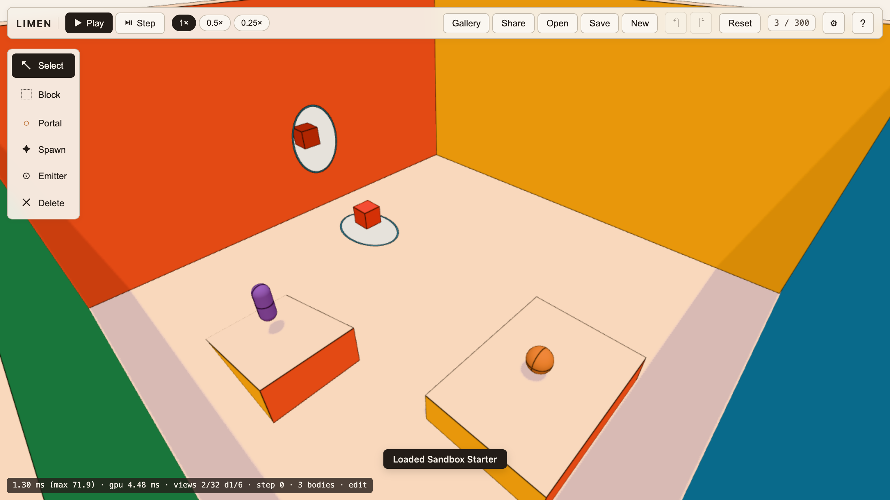

# Limen

Limen is a browser physics sandbox with linked portals. Place portal pairs on flat static walls, build structures with blocks and ramps, spawn rigid bodies, and watch physics carry them across thresholds. It runs on three.js and Rapier 3D in an off-thread Web Worker with zero build step. It grew out of the lab behind the portals film by [@anxchywl](https://github.com/anxchywl).



## Features

- **Linked portals:** recursive views rendered with stencil masks, oblique near-plane clipping, and depth tints.
- **Portal transit physics:** swept-plane teleports, continuous clone tracking, and momentum conservation via Rapier 3D.
- **Off-thread simulation:** physics runs in a Web Worker at 60 Hz with interpolated rendering and zero main-thread hitching.
- **Interactive editor:** block placement, portal positioning, rigid body spawning, and continuous undo/redo history.
- **Sharing and persistence:** share scenes through compressed URL hashes (`#s=...`), local autosave, and `.limen.json` export/import.
- **Built-in gallery:** 8 example scenes demonstrating loops, flings, recursive corridors, domino runs, and portal mechanics.
- **Adaptive quality:** dynamic resolution and recursion depth ladder maintaining 60 fps on desktop and mobile.

## Getting started

Serve the repository with any local static HTTP server:

```bash
python3 -m http.server 5180
```

Open `http://localhost:5180` in a browser supporting WebGL2 and WebAssembly.

### Controls

- **Orbit Camera:** Left-drag to rotate, right-drag to pan, scroll to zoom.
- **Fly Camera:** Toggle mode in settings or inspector; WASD to fly, QE for up/down.
- **Edit / Play:** Press `Space` to toggle between pause/edit and real-time physics.
- **Step:** Press `.` or click the step button to advance one physics step.
- **Slow Motion:** Press `T` to cycle through 1×, 0.25×, and 0.1× speeds.
- **Undo / Redo:** `Ctrl+Z` / `Cmd+Z` and `Ctrl+Shift+Z` / `Cmd+Shift+Z`.
- **Diagnostics:** Press backtick (` ` `) to toggle the performance overlay.

## Limits

- **One transit per body:** a body can only pass through one portal pair at a time; secondary crossings wait until the body leaves the first transit zone.
- **Portal pairing:** portals are linked in symmetric 1-to-1 pairs and share identical dimensions (1.4 m × 2.0 m).
- **Static hosts only:** portals can only be placed on planar faces of static blocks or boundary walls, not on moving bodies.
- **Far-side collisions:** geometry visible through an exit portal is approximated for collisions using ghost colliders within a 3-metre radius.
- **Caps:** up to 300 dynamic bodies on desktop (120 on mobile), 4 portal pairs, recursion depth of 6, and 8 emitters.

## License

[MIT](LICENSE) · Copyright (c) 2026 anxchywl
